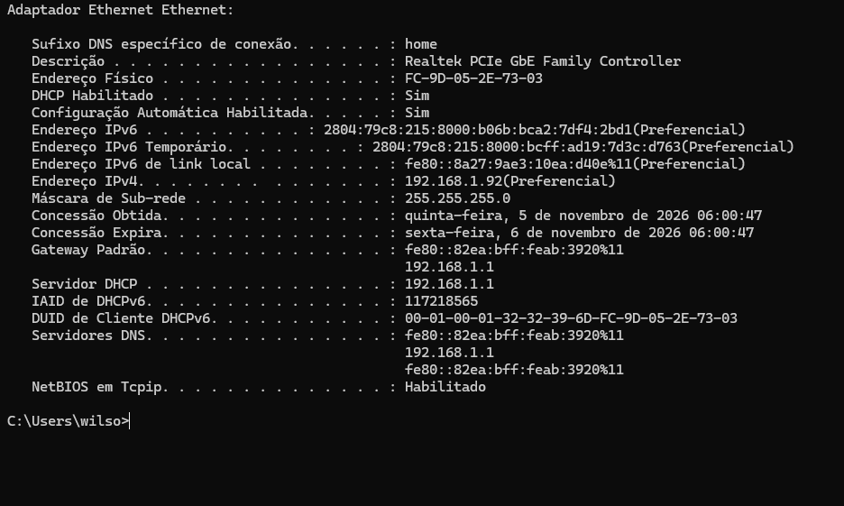
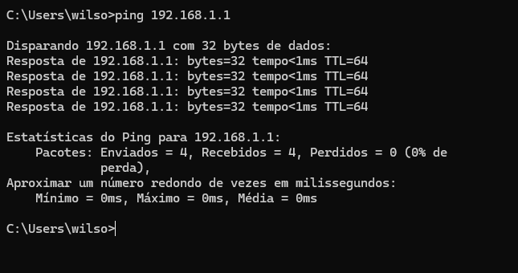
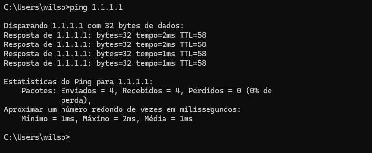
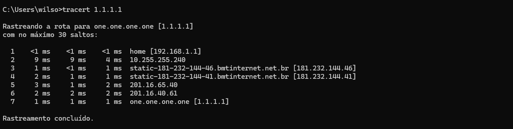

# LAB-002 — Network Troubleshooting & DNS Diagnostics

**Author:** Wilson Jr  
**Category:** IT Support / Network Troubleshooting  
**Lab Type:** Practical Windows Network Assessment  
**Status:** Completed  
**Date:** 05 November 2026

---

## 1. Objective

Assess local and external network connectivity on a Windows computer using native command-line tools. Verify IP configuration, gateway accessibility, DNS resolution and network routing.

## 2. Tools Used

- Windows Command Prompt
- ipconfig
- ping
- nslookup
- tracert

## 3. Network Configuration

The command `ipconfig /all` was used to inspect the active Ethernet adapter.

| Parameter | Observed Value |
|---|---|
| Network Adapter | Realtek PCIe GbE Family Controller |
| IPv4 Address | 192.168.1.92 |
| Subnet Mask | 255.255.255.0 |
| Default Gateway | 192.168.1.1 |
| DHCP Server | 192.168.1.1 |
| DNS Server (IPv4) | 192.168.1.1 |
| DHCP | Enabled |

**Assessment:** The computer had a valid private IPv4 address, an assigned default gateway and DHCP configuration. No obvious IPv4 configuration errors were identified.

## 4. Local Gateway Connectivity

**Command:** `ping 192.168.1.1`

| Metric | Result |
|---|---|
| Packets Sent | 4 |
| Packets Received | 4 |
| Packet Loss | 0% |
| Response Time | Less than 1 ms |

**Assessment:** The local gateway responded successfully to all four ICMP requests. No packet loss was observed.

## 5. External Network Connectivity

**Command:** `ping 1.1.1.1`

| Metric | Result |
|---|---|
| Destination | Cloudflare DNS |
| Packets Sent | 4 |
| Packets Received | 4 |
| Packet Loss | 0% |
| Minimum Latency | 1 ms |
| Maximum Latency | 2 ms |
| Average Latency | 1 ms |

**Assessment:** The computer successfully reached an external IPv4 destination without packet loss during the test.

## 6. DNS Resolution

**Command:** `nslookup google.com`

The DNS query returned the following addresses:

- IPv4: 172.217.29.142
- IPv6: 2800:3f0:4002:807::200e

The configured DNS resolver responded successfully. The message "Server: UnKnown" did not indicate a failed DNS query.

**Assessment:** DNS name resolution was functional during the test.

## 7. Network Route Tracing

**Command:** `tracert 1.1.1.1`

The route to the external destination was completed in seven hops.

| Metric | Result |
|---|---|
| Destination | 1.1.1.1 |
| Total Hops | 7 |
| Final Hop Response | 1 ms |
| Trace Status | Completed |

**Assessment:** The trace reached its destination successfully. No timeouts were observed in the displayed route.

## 8. Overall Diagnostic Results

| Test | Result |
|---|---|
| IP Configuration | Passed |
| Local Gateway Connectivity | Passed |
| External IPv4 Connectivity | Passed |
| DNS Resolution | Passed |
| Route Tracing | Passed |

## 9. Technical Conclusion

The diagnostic assessment confirmed valid IPv4 configuration, successful local gateway communication, external IPv4 connectivity, functional DNS resolution and a completed route trace.

No connectivity faults were identified during the tests performed.

These results represent a point-in-time assessment and do not rule out intermittent connectivity problems or issues affecting other destinations, protocols or applications.

## 10. Skills Demonstrated

- Windows network configuration analysis
- IPv4 addressing and DHCP fundamentals
- ICMP connectivity testing
- DNS troubleshooting
- Network route tracing
- Structured technical documentation
- Entry-level IT support diagnostic procedures

## 11. Recommended Follow-Up

- Test connectivity under different network conditions.
- Compare DNS resolution using alternative resolvers.
- Investigate intermittent packet loss if reported.
- Review network adapter drivers and settings if connectivity issues occur.
- Document additional troubleshooting scenarios and corrective actions.
