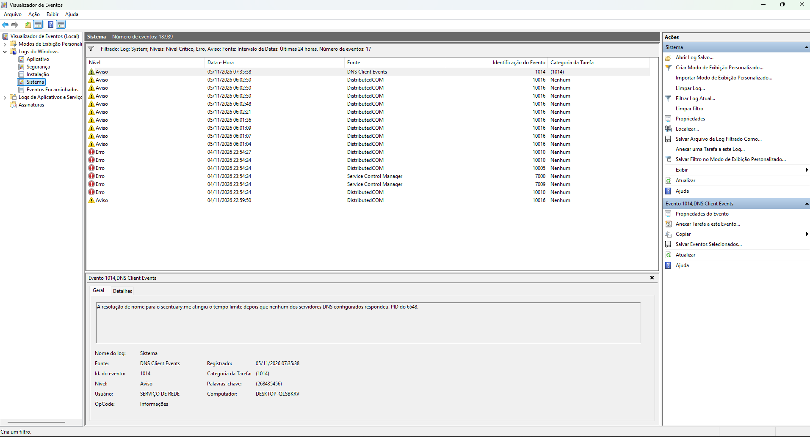
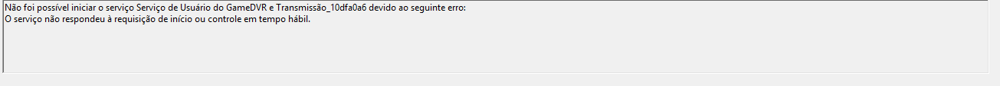
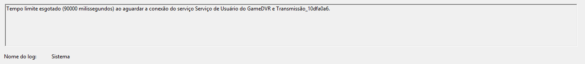
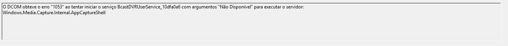
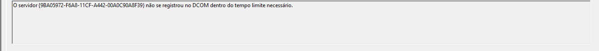
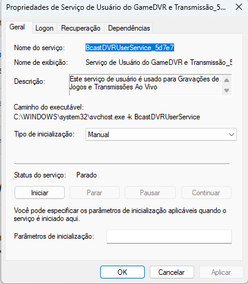

# LAB-003 — Windows Event Viewer & System Error Analysis

**Author:** Wilson Jr  
**Category:** Windows Troubleshooting / IT Support  
**Lab Type:** Windows Event Log Investigation  
**Status:** Investigation Completed  
**Date:** 05 November 2026

---

## 1. Objective

Investigate Windows system errors and warnings using Event Viewer, correlate related events, identify potentially affected services, and perform functional validation.

## 2. Tools Used

- Windows Event Viewer (`eventvwr.msc`)
- Windows Services (`services.msc`)
- Xbox Game Bar
- Windows screen recording functionality

## 3. Diagnostic Procedure

1. Opened Windows Event Viewer.
2. Navigated to Windows Logs > System.
3. Filtered critical, error, and warning events from the previous 24 hours.
4. Identified 17 matching events.
5. Examined Service Control Manager and DistributedCOM errors.
6. Inspected the GameDVR service configuration.
7. Tested Xbox Game Bar functionality.
8. Successfully recorded and played back a test video.

## 4. Events Identified

| Event ID | Source | Finding |
|---|---|---|
| 7000 | Service Control Manager | GameDVR service failed to start |
| 7009 | Service Control Manager | 90-second service connection timeout |
| 10005 | DistributedCOM | Error 1053 while starting GameDVR |
| 10010 | DistributedCOM | COM server registration timeout |
| 10016 | DistributedCOM | Permission-related warnings observed |
| 1014 | DNS Client Events | DNS resolution timeout |

## 5. GameDVR Investigation

Events 7000, 7009 and 10005 were associated with a GameDVR service startup failure.

Event 7009 recorded a timeout of 90,000 milliseconds.

Event 10005 reported error 1053 when attempting to start a GameDVR service required by a Windows media capture component.

A GameDVR service instance was subsequently inspected using Windows Services.

**Observed configuration:**

- Startup type: Manual
- Service status: Stopped
- Executable: svchost.exe

The inspected service instance had a different per-user suffix from the instance identified in the earlier errors. Therefore, the observations cannot be assumed to refer to the same service instance.

## 6. Functional Validation

The following tests were performed:

| Test | Result |
|---|---|
| Launch Xbox Game Bar | Passed |
| Start screen recording | Passed |
| Stop screen recording | Passed |
| Play recorded video | Passed |

The tests confirmed that the Game Bar interface and recording functionality were operational during the investigation.

## 7. Technical Analysis

The historical events indicate a GameDVR service startup timeout.

However, functional testing did not reproduce a recording failure.

The original cause of the timeout remains undetermined.

The DistributedCOM 10010 and DNS Client 1014 events were also observed, but no direct causal relationship with the GameDVR startup failure was established.

No hardware failure was confirmed.

## 8. Conclusion

The investigation successfully identified and correlated Windows service startup errors using Event Viewer.

Functional testing demonstrated that Xbox Game Bar and video recording were operational despite the historical errors.

No configuration changes were required based on the available evidence.

Further investigation would be appropriate if the errors recur alongside observable functional problems.

## 9. Skills Demonstrated

- Windows Event Viewer analysis
- Event ID identification and correlation
- Windows service inspection
- Service startup timeout analysis
- Functional troubleshooting
- Evidence-based technical conclusions
- IT support documentation

- ## 10. Diagnostic Evidence

### 10.1 Windows Event Viewer — System Log

### 10.2 Event 7000 — GameDVR Startup Failure

### 10.3 Event 7009 — Service Timeout

### 10.4 Event 10005 — DistributedCOM Error

### 10.5 Event 10010 — DCOM Registration Timeout

### 10.6 GameDVR Service Properties

### Evidence Summary
The screenshots document the Windows event log investigation and the observed GameDVR service configuration. Functional recording tests were completed successfully, as described in Section 6.
